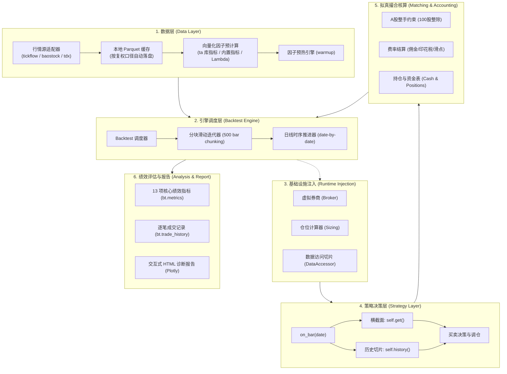

# 架构设计

QKA 采用了 **声明式向量计算 + 事件驱动轻量回测** 的混合架构。既保留了向量化因子计算在处理大规模数据时的极速优势，又兼具事件驱动模型在模拟真实撮合、滑点扣费和动态仓位控制时的拟真度。

---

## 总体架构全景



---

## 核心设计要点

### 1. 宽表组织与跨标的横截面
`Data.get()` 返回的是标准的长宽结构 `pd.DataFrame`：
- **行索引（Index）**：为交易日 `pd.Timestamp`。
- **列索引（Columns）**：采用 `{symbol}|{factor}` 的统一复合命名规则（例如 `000001.SZ|close`、`600000.SH|sma_20`）。
- **内置常驻列**：除开高低收成交额外，`Data` 始终自动计算 `{symbol}|returns`（日收益率），无需手动重复声明。

在策略执行阶段，`self.get('factor_name')` 会在 $O(1)$ 复杂度下切片出当天的横截面 `pd.Series`，以股票代码为索引，极大简化了多标的、全市场策略的编写。

### 2. 运行时无缝注入模式
与 Backtrader 等框架需要用户手动构造复杂的上下文环境不同，在 QKA 中，用户只需实现纯粹的策略逻辑：
```python
class MyStrategy(Strategy):
    def on_bar(self, date):
        # broker, sizing, _data 均由 Backtest 在执行时动态注入
        ...
```
这种设计将策略的**业务逻辑**与回测引擎的**运行状态**彻底解耦，便于针对策略进行单元测试，也利于大模型无差错生成代码。

### 3. 分块迭代与内存优化
当回测区间跨度极大（大于 500 个交易日）时，`Backtest` 内部会自动按 500 bar 的窗口进行分块滑动推进，避免一次性在内存中维护超大规模的临时对象，保证长期回测的稳定流畅。

### 4. 严格防范未来函数设计
- 策略在 `date` 当天通过 `self.get()` 只能获取截止到当天的因子值。
- 通过 `self.history(factor, N)` 只能获取 `[date - N + 1, date]` 区间内的历史滑动窗口。
- 绝无任何途径从 `Strategy` 内部提前探测未来数据，从架构根源上杜绝了量化研究中最致命的「未来函数陷阱」。
