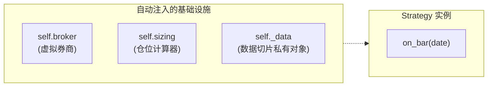

# 策略编写规范

所有在 QKA 中运行的交易策略，都必须继承 `qka.Strategy` 并实现 `on_bar(self, date)` 抽象方法。

---

## 策略基类结构

```python
from qka import Strategy

class MyStrategy(Strategy):
    def __init__(self):
        super().__init__()
        # 在这里初始化策略的自定义参数
        self.fast_period = 5
        self.slow_period = 20
        self.trade_pct = 0.1

    def on_bar(self, date):
        # 核心交易决策逻辑，每日开盘/收盘时推进触发一次
        close = self.get('close')
        ...
```

### 关键约束

| 约束项 | 正确做法 | 错误做法（禁止） |
|--------|----------|------------------|
| **`__init__`** | 必须调用 `super().__init__()`，无参数 | 传递参数给 `super().__init__(...)` |
| **策略参数** | 直接绑定在 `self` 实例属性上，如 `self.fast = 5` | 使用 `self.params.get('fast')`（不存在 params 字典） |
| **基础设施** | 由回测引擎在 `run()` 时动态注入，无需在 `__init__` 创建 | 在 `__init__` 中实例化 `Broker` 或 `Sizing` |
| **`on_bar` 签名** | 严格为 `def on_bar(self, date):` | 写成 `def on_bar(self, date, get):`（旧版已废弃） |

---

## 数据获取接口

在 `on_bar(date)` 方法内部，可以通过两种标准接口安全获取行情数据：

### 1. `self.get(factor: str) -> pd.Series`
获取**当前交易日**所有标的的指定因子横截面数据。

- **返回值**：`pd.Series`，以股票代码为 Index，因子当前值为 Values。
- **复杂度**：$O(1)$ 常数时间切片。

```python
def on_bar(self, date):
    # 获取当日所有股票的最新收盘价横截面
    close = self.get('close')
    # 获取当日预计算的 20 日均线
    sma_20 = self.get('sma_20')

    for sym in close.index:
        current_price = float(close[sym])
        ma = float(sma_20[sym])
        if current_price > ma:
            ...
```

### 2. `self.history(factor: str, window: int = 20) -> pd.DataFrame`
获取截止到**当前交易日**为止的前 `window` 个交易日的时序滑动窗口。

- **返回值**：`pd.DataFrame`，行索引为日期（时间升序），列为股票代码。
- **复杂度**：严格限定在 `window` 区间内，绝不越界暴露未来数据。

```python
def on_bar(self, date):
    # 获取平安银行过去 10 天的收盘价序列
    hist_close = self.history('close', window=10)
    pa_trend = hist_close['000001.SZ']

    # 检查过去 3 天是否连续放量
    hist_vol = self.history('volume', window=3)
    if hist_vol['000001.SZ'].is_monotonic_increasing:
        ...
```

---

## 运行时注入组件

当回测启动后，回测引擎会自动为策略实例注入以下上下文对象：



- **`self.broker`**：虚拟券商实例，提供 `self.broker.buy()`、`self.broker.sell()`，以及 `self.broker.cash`（可用资金）和 `self.broker.positions`（当前持仓字典）。
- **`self.sizing`**：仓位控制计算器，提供 `self.sizing.percent()`、`self.sizing.fixed_shares()` 等按手取整的仓位计算。

---

## 典型策略范例：全市场动量轮动

以下是一个展示多标的横截面处理能力的动量轮动策略示例：

```python
from qka import Strategy

class MomentumRotation(Strategy):
    def __init__(self):
        super().__init__()
        self.top_k = 3        # 每次持仓最强的前 3 只股票
        self.lookback = 20    # 20 日收益率动量

    def on_bar(self, date):
        close = self.get('close')
        returns_hist = self.history('returns', window=self.lookback)

        # 1. 计算过去 20 日累计收益率并排序
        cum_returns = (1 + returns_hist).prod() - 1
        top_candidates = cum_returns.sort_values(ascending=False).head(self.top_k).index.tolist()

        # 2. 检查现有持仓：不在候选集里的卖出
        for sym, pos in list(self.broker.positions.items()):
            if sym not in top_candidates and pos['size'] > 0:
                price = float(close[sym])
                if price > 0:
                    self.broker.sell(sym, price, pos['size'])

        # 3. 买入新入选的标的，平分可用资金
        if top_candidates:
            target_pct = 1.0 / len(top_candidates)
            for sym in top_candidates:
                if sym not in self.broker.positions or self.broker.positions[sym]['size'] == 0:
                    price = float(close[sym])
                    if price > 0:
                        size = self.sizing.percent(target_pct, price)
                        if size > 0:
                            self.broker.buy(sym, price, size)
```
